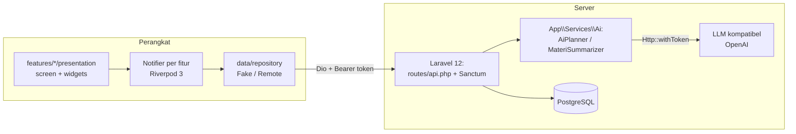
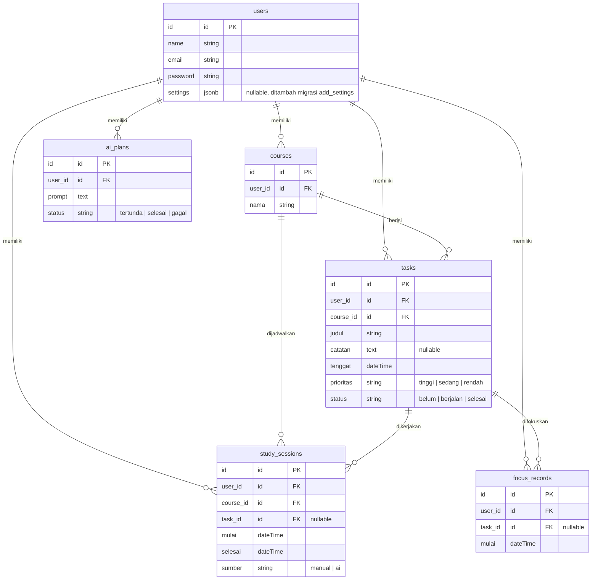
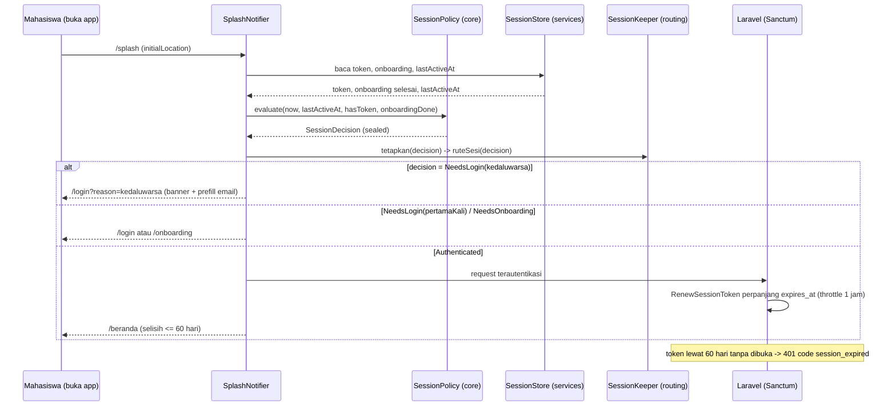
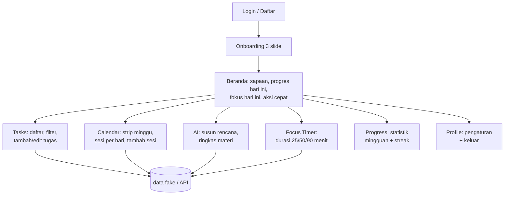

# Arsitektur MyPlan (AI Study Planner)

Dokumen ini menjelaskan arsitektur aplikasi Flutter dan backend Laravel.
Semua nama tabel, kolom, endpoint, dan nama file diambil langsung dari kode.

## 1. Gambaran umum

Aplikasi Flutter hanya berbicara ke data lewat satu jendela: **repository**.
Sumber data dipilih lewat `--dart-define=USE_FAKE=true|false` di
`lib/bootstrap.dart`: `FakeRepository` (in-memory, mode demo) atau
`RemoteRepository` (Dio ke endpoint Laravel). AI selalu dipanggil lewat backend —
kunci API LLM hanya ada di `backend/.env` (`config('ai.key')`), tidak pernah
dibundel ke aplikasi.



Tiga lapisan di perangkat dipisah tegas:

- `core/` — Dart murni: model nilai (`Task`, `Course`, `StudySession`,
  `FocusRecord`), `Result`/`sealed Failure`, dan `Clock` (waktu disuntik agar
  test deterministik, bukan `DateTime.now()` langsung di fitur).
- `data/` — `ApiClient` (Dio, interceptor Bearer, penanganan 401 lewat
  `TokenStorage`), repository fake & remote, dan observer status login.
- `features/<fitur>/presentation/` — screen, widget, dan satu notifier per
  fitur. Fitur tidak mengimpor fitur lain.

## 2. ERD (dari `backend/database/migrations/`)



Semua kolom asing memakai `foreignId()->constrained()->cascadeOnDelete()`.
Selain tabel di atas ada tabel bawaan Laravel: `cache`, `jobs`, dan
`personal_access_tokens` (Sanctum).

## 3. Alur AI Planner (susun rencana belajar)

```mermaid
sequenceDiagram
    participant U as Mahasiswa
    participant A as Aplikasi (fitur ai_planner)
    participant B as Laravel (AiPlanController)
    participant P as OpenAiCompatibleProvider
    participant L as LLM

    U->>A: tekan "Susun slot belajar otomatis"
    A->>B: POST /ai/plan (throttle 5/menit)
    B->>B: kumpulkan konteks (waktu luang settings, tugas belum/berjalan, catatan)
    B->>P: prompt sistem + prompt pengguna
    P->>L: POST {AI_BASE_URL}/chat/completions
    L-->>P: teks rencana (JSON)
    P-->>B: teks jawaban
    alt LLM gagal / kunci kosong
        B->>B: DeterministicPlanner (heuristik waktu luang)
    end
    B->>B: PlanValidator menyaring blok yang valid
    B-->>A: daftar blok (course, mulai, selesai)
    A->>U: pratinjau blok; tiap blok bisa diubah jamnya (showTimePicker)
    U->>A: tekan "Terapkan ke Kalender"
    A->>B: POST /sessions/bulk (sumber = ai)
    B-->>A: 201 Created
    A->>U: snackbar sukses, pindah ke tab Kalender
```

Jika koneksi aplikasi ke backend gagal, kegagalan diterjemahkan menjadi nilai
`sealed Failure` dan ditampilkan lewat `AsyncValue` (kartu `ErrorRetryCard`
dengan tombol coba ulang di layar AI), bukan dibungkam.

## 4. Alur ringkas materi

Fitur Ringkas Materi memanggil `POST /ai/summarize` (throttle 10/menit).
Teks mata kuliah dibatasi `summarize_max_chars = 20 000` karakter
(`backend/config/ai.php`). `MateriSummarizer` menghasilkan ringkasan, daftar
poin, dan 5 pertanyaan latihan. Hasil bisa disimpan sebagai catatan pada sebuah
tugas (`simpanSebagaiCatatan` → `PUT /tasks/{task}` dengan kolom `catatan`
terisi).

## 5. Autentikasi dan sesi (Fase E)

- Token Sanctum dengan masa berlaku 60 hari; tabel `personal_access_tokens`.
- Flutter: `TokenStorage` (flutter_secure_storage) menyimpan token,
  SharedPreferences menyimpan `lastActiveAt` + email terakhir
  (`SessionStore`); `SessionPolicy.maxIdle = 60 hari` sumber tunggal batas.
- `Dio` menyuntikkan header `Authorization: Bearer`; 401 diteruskan sebagai
  `UnauthorizedInfo{path, code}` — pemilahannya di `sambungkanPengecualian401`
  (`lib/bootstrap.dart`): 401 login/register diabaikan, `session_expired`
  menggugurkan sesi dengan banner, 401 lain login polos.
- Backend: register/login memberi token 60 hari; middleware
  `RenewSessionToken` memperpanjang `expires_at` (throttle tulis via Cache
  60 menit/token); jadwal harian `sanctum:prune-expired --hours=24`;
  `AuthenticationException` yang kehabisan masa berlaku menghasilkan 401
  `code: session_expired`.
- Redirect guard urutannya: belum login → `/login` (dengan banner bila
  kedaluwarsa); login tapi belum onboarding → `/onboarding`; sudah lengkap
  dan membuka halaman auth → `/beranda`.

Alur sesi & splash saat aplikasi dibuka:



Saat aplikasi berjalan dan respons 401 datang di tengah pemakaian
(`session_expired`), ApiClient menghapus sesi lalu menginformasikan
`SessionKeeper` sehingga router langsung menuju `/login` dengan banner.

## 6. Kasus penggunaan utama



Aksi cepat di beranda dipakai `Wrap` (bukan `GridView`) agar baris aksi bisa
melipat ke bawah pada skala teks besar.

## 7. Keputusan teknis penting

| Keputusan | Alasan |
| --- | --- |
| Fake vs Remote lewat `USE_FAKE` | Demo magang bisa jalan tanpa backend, hanya ganti dart-define, tanpa mengubah kode. |
| `sealed Failure` + `AsyncValue` | Kegagalan jaringan adalah nilai bertipe; tidak ada catch kosong. |
| `Clock` disuntik | Kalender, tugas, dan fokus memakai hari tetap (9 Nov 2026) di test. |
| Kebijakan sesi murni (`sealed SessionDecision`) | `SessionPolicy` tanpa Flutter; guard, splash, dan test memakai keputusan yang sama dengan satu sumber kebenaran `maxIdle`. |
| Splash offline-first | Warm-up tidak menunggu jaringan (maks 4 s); keputusan sesi murni lokal dari penyimpanan perangkat. |
| l10n dictionary hand-written | codegen `flutter gen-l10n` gagal pada layout arb proyek ini (l10n.yaml dihapus, lihat `docs/sesi.md`); dictionary sederhana dengan fallback aman ke kunci. |
| `BackdropFilter` dibatasi | Hanya `GlassCard` (varian hero) dan `GlassBottomBar` memakai blur; item dalam daftar memakai panel semi-transparan tanpa blur. |
